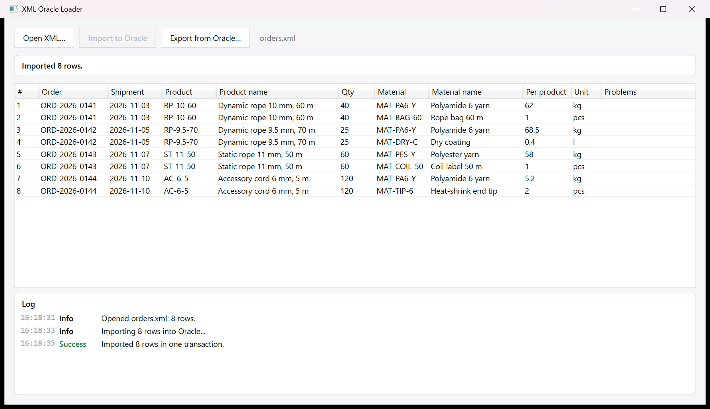
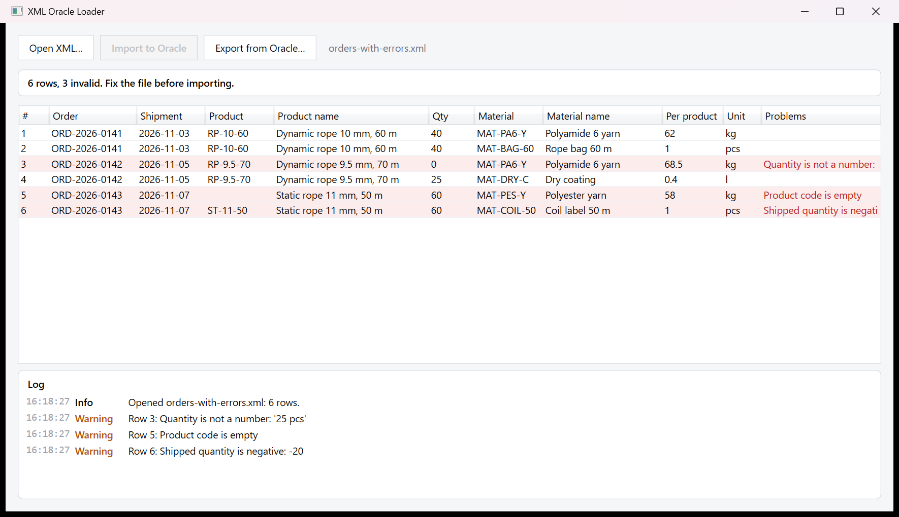

# XML Oracle Loader

[](https://github.com/OlgaAntonikova/xml-oracle-loader/actions/workflows/ci.yml)
[](LICENSE)

A Windows desktop tool that loads production order lines exported from **1C:Enterprise** into an **Oracle** database, and exports them back to XML.

You open the XML export and see every row in a grid before anything touches the database. Invalid rows are highlighted with the reason. The import runs only when the whole file is valid, and it goes in a single transaction, so either every row is saved or none is.





## Features

- **Preview before import**: parses the 1C `ValueTable` XML and shows all rows in a grid
- **Validation**: required fields, numbers (`12.5` or `12,5`, thousands spaces), no negative quantities. Each problem is reported with its row number
- **Safe import**: one transaction with ODP.NET array binding (a single round trip). A second click cannot import the same rows twice
- **Export** of the Oracle table back to XML in the format the 1C side reads
- **Log panel**: every step and error is logged, and the app never crashes on bad input or a missing database
- **No credentials in the repository**: connection settings come from environment variables

## Tech stack

| Area | Technology |
|---|---|
| UI | WPF, MVVM (no framework: own `ObservableObject` / `AsyncRelayCommand`) |
| Runtime | .NET 8 |
| Database | Oracle Database, `Oracle.ManagedDataAccess.Core` (ODP.NET) |
| XML | LINQ to XML |
| Tests | xUnit (parser, mapping and validation, settings, view model) |
| CI | GitHub Actions on `windows-latest` |

## Architecture

```text
XmlOracleLoader.Core         net8.0          XML parser, OrderLine model, 1C column mapping and validation,
                                             XML exporter, DbSettings, IOrderLineRepository
XmlOracleLoader.ViewModels   net8.0          MainViewModel, commands, log; no WPF dependency
XmlOracleLoader              net8.0-windows  WPF views, file dialogs, OracleOrderLineRepository
XmlOracleLoader.Tests        net8.0          xUnit tests for Core and ViewModels
```

The view models do not reference WPF, so the whole UI logic is tested with fakes for the file dialogs and the repository.

## Input format

The input is a 1C:Enterprise `ValueTable` serialized to XML (namespace `http://v8.1c.ru/8.1/data/core`). The 1C configuration names its columns in Russian. These names are part of the file format, so they stay as data in [`OneCColumns`](XmlOracleLoader/XmlOracleLoader.Core/Mapping/OneCColumns.cs), and the rest of the code uses English names:

| 1C column | Property | Oracle column |
|---|---|---|
| НомерЗаказа | `OrderNumber` (required) | `N_ZAK` |
| ДатаОтгрузки | `ShipmentDate` | `DATE_OTG` |
| Количество | `Quantity` (required, number) | `QTY` |
| ОбозначениеПродукции | `ProductCode` (required) | `ART` |
| НаименованиеПродукции | `ProductName` | `NAME` |
| КоличествоНаИзделие | `QuantityPerProduct` (number) | `QTY_NA_IZD` |
| Обозначение | `MaterialCode` | `ART_MAT` |
| Наименование | `MaterialName` | `NAME_MAT` |
| ЕдиницаИзмерения | `UnitOfMeasure` | `ED_IZM` |
| ДлинаВеревки | `RopeLength` | `ROAT` |
| МаршрутДвижения | `Route` | `MARSHRUT` |
| ГруппаИзделия | `ProductGroup` | `GROUP_ITEM` |
| КлассИзделия | `ProductClass` | `CLASS_ITEM` |
| ЭтоУпаковка | `IsPackaging` | `UPAK` |
| КоличествоОтгрузка | `ShippedQuantity` (number) | `QTY_OTG` |
| УкрупненноеПроизводственноеЗадание | `ProductionTask` | `PVZ` |

Sample files: [`samples/orders.xml`](samples/orders.xml) (valid) and [`samples/orders-with-errors.xml`](samples/orders-with-errors.xml).

## Getting started

Requirements: Windows, the [.NET 8 SDK](https://dotnet.microsoft.com/download/dotnet/8.0) and Docker (for a local Oracle).

**1. Start Oracle Database Free locally**

```powershell
docker run -d --name xol-oracle -p 127.0.0.1:1521:1521 `
  -e ORACLE_RANDOM_PASSWORD=yes -e APP_USER=xol -e APP_USER_PASSWORD=<choose-a-password> `
  gvenzl/oracle-free:23-slim
```

Wait until `docker logs xol-oracle` shows `DATABASE IS READY TO USE!`.

**2. Create the table**

```powershell
Get-Content database/create_table.sql | docker exec -i xol-oracle sqlplus -s xol/<password>@FREEPDB1
```

**3. Configure the connection and run**

```powershell
$env:XOL_DB_USER = "xol"
$env:XOL_DB_PASSWORD = "<password>"
dotnet run --project XmlOracleLoader/XmlOracleLoader -- samples/orders.xml
```

The file passed on the command line opens right away. Without a database you can still open files and see the validation.

## Configuration

Each setting is read from an environment variable first, then from `App.config`, which ships without credentials.

| Environment variable | App.config key | Default |
|---|---|---|
| `XOL_DB_HOST` | `DbHost` | `localhost` |
| `XOL_DB_PORT` | `DbPort` | `1521` |
| `XOL_DB_SERVICE` | `DbServiceName` | `FREEPDB1` |
| `XOL_DB_USER` | `DbUserId` | — |
| `XOL_DB_PASSWORD` | `DbPwd` | — |

## Tests

```powershell
dotnet test XmlOracleLoader/XmlOracleLoader.sln
```

The unit tests do not need a database. Import and export were also checked end-to-end against Oracle Database Free in Docker.

## License

[MIT](LICENSE)
